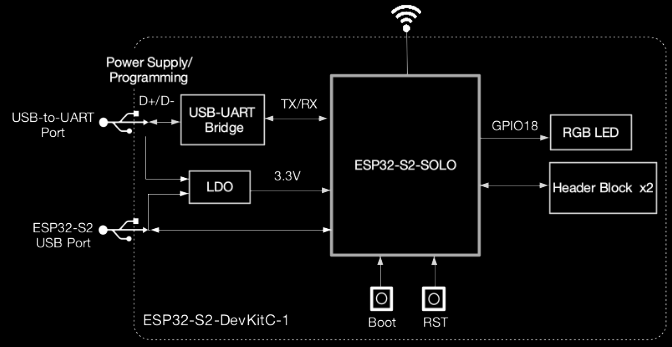
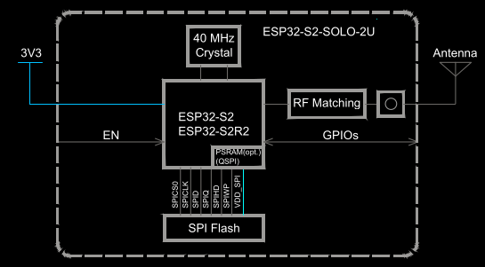
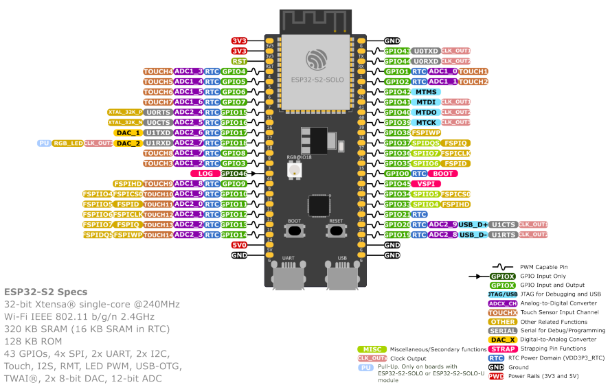

# chipe esp32-S2

## Block diagram chip


## WIFI
  - IEEE 802.11 b/g/n-compliant• Automatic Beacon monitoring (hardware TSF)
  - Supports 20 MHz, 40 MHz bandwidth in 2.4 GHz band
  - 4 × virtual Wi-Fi interfaces
  - Simultaneous support for Infrastructure Station,SoftAP, and Promiscuous modes and performs a scan, the SoftAP channel will change along with the Station channel.
  > Note that when ESP32-S2 is in Station mode
  - Single-band 1T1R mode with data rate up to 150 Mbps
  - WMM
  - TX/RX A-MPDU, RX A-MSDU
  - Antenna diversity
  - Immediate Block ACK
  - 802.11mc FTM
  - Fragmentation and defragmentation

## CPU and Memory
  - Xtensa® single-core 32-bit LX7 microprocessor,up to 240 MHz
  - 16 KB SRAM in RTC
  - Embedded flash and PSRAM (see details in Chapter 1: ESP32-S2 Series Comparison)
  - CoreMark score: 1 core at 240 MHz: 472.73 CoreMark; 1.97 CoreMark/MHz
  - SPI/QSPI/OSPI supports multiple flash and external RAM chips
  - 128 KB ROM
  - Access to flash accelerated by cache
  - Supports flash in-Circuit Programming (ICP)
  - 320 KB SRAM
  - 40MHz crystal oscillator

## Advanced Peripheral Interfaces
  - 43 × programmable GPIOs
  - 4 × pulse counters (4 contadores físicos)

  Digital interfaces:
  - 4 × SPI
  - 1 × I2S
  - 2 × I2C
  - 2 × UART
  - 4 × pulse counters
  - Digital interfaces:– 1 × full-speed USB OTG
  - 1 × DVP 8/16 camera interface, implemented using the hardware resources of I2S
  - 1 × LCD interface (8-bit serial RGB/8080/6800), implemented using the hardware resources of I2S
  - 1 × LCD interface (8/16/24-bit parallel),implemented using the hardware resources of I2S
  - DMA controller
  - 1 × TWAI controller compatible with ISO11898-1 (CAN Specification 2.0)
  - 14 × touch sensing GPIOs
  - 1 × temperature sensor

## Timers
  - 1 × 64-bit general-purpose timer
  - 1 × 64-bit system timer
  - 3 × watchdog timers
  - 1 × super watchdog timer
  - 1 × XTAL32K watchdog timer
  
## Secure boot
  - Flash encryption
  - 4096-bit OTP, up to 1792 bits for users
  - Cryptographic hardware acceleration:
    - Hash (FIPS PUB 180-4)
    - HMAC
    - Random Number Generator (RNG)
    - RSA
    - AES-128/192/256 (FIPS PUB 197)
    - Digital signature

# Board info

  - Modelo: ESP32-S2-SOLO-2U-N8R2
  - Flash externa: 8MB
  - PSRAM:2MB.
  - External antenna conector
  
## Block diagram Module


## Module PINOUT




# Info shown with espidf on erase-flash

```txt
Executing action: erase-flash
Running esptool in directory '/home/carlos/Programing/microcontroladores/Projetos ESP/Scorbot-API/build'
Executing "/home/carlos/.espressif/python_env/idf6.2_py3.12_env/bin/python -m esptool -p /dev/ttyUSB0 -b 460800 --before default-reset --after hard-reset --chip esp32s2 erase-flash"...
esptool v5.3.1
Connected to ESP32-S2 on /dev/ttyUSB0:
Chip type:          ESP32-S2R2 (revision v1.0)
Features:           Wi-Fi, Single Core, 240MHz, No Embedded Flash, Embedded PSRAM 2MB, ADC and temperature sensor calibration in BLK2 of eFuse V2
Crystal frequency:  40MHz
MAC:                70:04:1d:fa:20:1c

Stub flasher running.
Changing baud rate to 460800...
Changed.

Erasing flash memory (this may take a while)...
```

# After flashing and seeing monitoring

```txt
esptool v5.3.1
Creating ESP32-S2 image...
Merged 3 ELF sections.
Successfully created ESP32-S2 image.
Generated /home/carlos/Programing/microcontroladores/Projetos ESP/Scorbot-API/build/Scorbot-API.bin
[1013/1014] cd "/home/carlos/Programing/microcontroladores/Projetos ESP/Scorbot-API/build" && /home/carlos/.espressif/python_env/idf6.2_py3.12_env/bin/python /home/carlos/Sources/esp-idf/components/partition_table/check_sizes.py --offset 0x8000 partition --type app /home/carlos/Programing/microcontroladores/Projetos\ ESP/Scorbot-API/build/partition_table/partition-table.bin /home/carlos/Programing/microcontroladores/Projetos\ ESP/Scorbot-API/build/Scorbot-API.bin
Scorbot-API.bin binary size 0xaa3d0 bytes. Smallest app partition is 0x100000 
bytes. 0x55c30 bytes (34%) free.
[1013/1014] Running utility command for flash
esptool --chip esp32s2 -p /dev/ttyUSB0 -b 460800 --before=default-reset --after=hard-reset write-flash --flash-mode dio --flash-freq 80m --flash-size 2MB 0x1000 bootloader/bootloader.bin 0x8000 partition_table/partition-table.bin 0x10000 Scorbot-API.bin --skip-flashed
esptool v5.3.1
Connected to ESP32-S2 on /dev/ttyUSB0:
Chip type:          ESP32-S2R2 (revision v1.0)
Features:           Wi-Fi, Single Core, 240MHz, No Embedded Flash, Embedded PSRAM 2MB, ADC and temperature sensor calibration in BLK2 of eFuse V2
Crystal frequency:  40MHz
MAC:                70:04:1d:fa:20:1c

Stub flasher running.
Changing baud rate to 460800...
Changed.

Configuring flash size...

Writing 'bootloader/bootloader.bin' at 0x00001000...
SHA digest in image updated.
Flash will be erased from 0x00001000 to 0x00006fff...
Wrote 21776 bytes (13804 compressed) at 0x00001000 in 0.7 seconds (249.9 kbit/s).
Hash of data verified.

Writing 'partition_table/partition-table.bin' at 0x00008000...
Flash will be erased from 0x00008000 to 0x00008fff...
Wrote 3072 bytes (103 compressed) at 0x00008000 in 0.1 seconds (472.4 kbit/s).
Hash of data verified.

Writing 'Scorbot-API.bin' at 0x00010000...
Flash will be erased from 0x00010000 to 0x000bafff...
Wrote 697296 bytes (463796 compressed) at 0x00010000 in 11.7 seconds (476.3 kbit/s).
Hash of data verified.

Hard resetting via RTS pin...
Executing action: monitor
Running idf_monitor in directory '/home/carlos/Programing/microcontroladores/Projetos ESP/Scorbot-API'
Executing "/home/carlos/.espressif/python_env/idf6.2_py3.12_env/bin/python /home/carlos/Sources/esp-idf/tools/idf_monitor.py -p /dev/ttyUSB0 -b 115200 --toolchain-prefix xtensa-esp32s2-elf- --target esp32s2 --revision 0 '/home/carlos/Programing/microcontroladores/Projetos ESP/Scorbot-API/build/Scorbot-API.elf' '/home/carlos/Programing/microcontroladores/Projetos ESP/Scorbot-API/build/bootloader/bootloader.elf' -m '/home/carlos/.espressif/python_env/idf6.2_py3.12_env/bin/python' '/home/carlos/Sources/esp-idf/tools/idf.py' '-p' '/dev/ttyUSB0'"...
--- esp-idf-monitor 1.9.0 on /dev/ttyUSB0 115200
--- Quit: Ctrl+] | Menu: Ctrl+T | Help: Ctrl+T followed by Ctrl+H
ESP-ROM:esp32s2-rc4-20191025
Build:Oct 25 2019
rst:0x1 (POWERON),boot:0x8 (SPI_FAST_FLASH_BOOT)
SPIWP:0xee
mode:DIO, clock div:1
load:0x3ffe5110,len:0x15ec
load:0x4004a000,len:0xc0c
--- 0x4004a000: _stext at ??:?
load:0x4004e000,len:0x32c4
entry 0x4004a1a0
--- 0x4004a1a0: call_start_cpu0 at /home/carlos/Sources/esp-idf/components/bootloader/subproject/main/bootloader_start.c:27
I (21) boot: ESP-IDF v6.1-dev-6734-g102122904ad 2nd stage bootloader
I (21) boot: compile time Jul 30 2026 00:43:53
I (22) boot: chip revision: v1.0
I (24) boot: efuse block revision: v0.2
I (27) boot.esp32s2: SPI Speed      : 80MHz
I (31) boot.esp32s2: SPI Mode       : DIO
I (35) boot.esp32s2: SPI Flash Size : 2MB
I (39) boot: Enabling RNG early entropy source...
I (43) boot: Partition Table:
I (46) boot: ## Label            Usage          Type ST Offset   Length
I (52) boot:  0 nvs              WiFi data        01 02 00009000 00006000
I (59) boot:  1 phy_init         RF data          01 01 0000f000 00001000
I (65) boot:  2 factory          factory app      00 00 00010000 00100000
I (72) boot: End of partition table
I (75) esp_image: segment 0: paddr=00010020 vaddr=3f000020 size=183ech ( 99308) map
I (102) esp_image: segment 1: paddr=00028414 vaddr=3ffc7060 size=03fa8h ( 16296) load
I (106) esp_image: segment 2: paddr=0002c3c4 vaddr=40024000 size=03c54h ( 15444) load
I (111) esp_image: segment 3: paddr=00030020 vaddr=40080020 size=7af50h (503632) map
I (214) esp_image: segment 4: paddr=000aaf78 vaddr=40027c54 size=0f408h ( 62472) load
I (230) esp_image: segment 5: paddr=000ba388 vaddr=50000000 size=00024h (    36) load
I (240) boot: Loaded app from partition at offset 0x10000
I (240) boot: Disabling RNG early entropy source...
I (250) cache: Instruction cache        : size 8KB, 4Ways, cache line size 32Byte
I (250) cache: Data cache               : size 8KB, 4Ways, cache line size 32Byte
I (265) cpu_start: Unicore app
I (272) cpu_start: GPIO 44 and 43 are used as console UART I/O pins
I (272) cpu_start: Pro cpu start user code
I (273) cpu_start: cpu freq: 160000000 Hz
I (274) app_init: Application information:
I (278) app_init: Project name:     Scorbot-API
I (283) app_init: App version:      a894d34-dirty
I (287) app_init: Compile time:     Aug  8 2026 15:31:10
I (292) app_init: ELF file SHA256:  13c32d20b...
I (296) app_init: ESP-IDF:          v6.1-dev-6734-g102122904ad-dirt
I (302) efuse_init: Min chip rev:     v0.0
I (306) efuse_init: Max chip rev:     v1.99 
I (310) efuse_init: Chip rev:         v1.0
I (314) heap_init: Initializing. RAM available for dynamic allocation:
I (320) heap_init: At 3FFCFF10 len 0002C0F0 (176 KiB): RAM
I (325) heap_init: At 3FFFC000 len 00003A10 (14 KiB): RAM
I (331) heap_init: At 3FF9E000 len 00001FE8 (7 KiB): RTCRAM
I (337) spi_flash: detected chip: generic
I (340) spi_flash: flash io: dio
W (343) spi_flash: Detected size(8192k) larger than the size in the binary image header(2048k). Using the size in the binary image header.
I (356) main_task: Started on CPU0
I (356) main_task: Calling app_main()

========================================
          SCORBOT CHIP INFO
========================================
IDF version : v6.1-dev-6734-g102122904ad-dirt
Chip model  : 2
Revision    : 100
CPU cores   : 1

--- Memory ---
Free heap   : 188564 bytes
Minimum heap: 188564 bytes
Physical Flash : 8388608 bytes
========================================

W (386) wifi:wifi osi_nvs_open fail ret=4353

W (396) wifi_init: Failed to unregister Rx callbacks
E (396) wifi_init: Failed to deinit Wi-Fi driver (0x3001)
E (406) wifi_init: Failed to deinit Wi-Fi (0x3001)
Houve um erro ao iniciar o WiFi: ESP_ERR_NVS_NOT_INITIALIZED
Failed to connect to STA: ESP_ERR_WIFI_NOT_INIT
MDNS Init failed: ESP_FAIL
I (416) main_task: Returned from app_main()
```